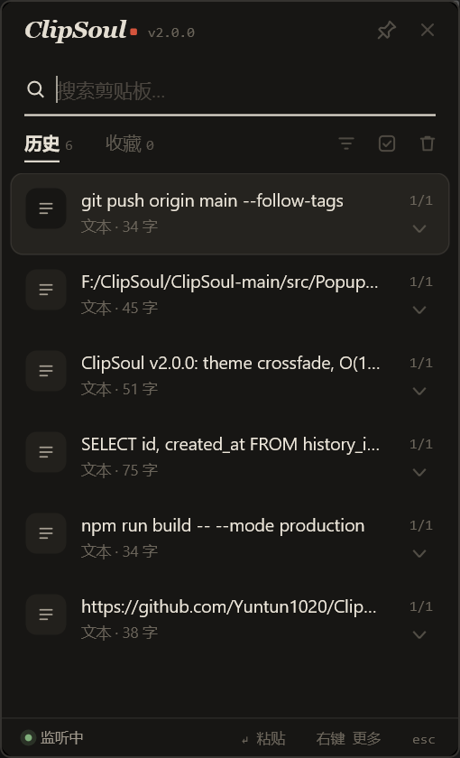
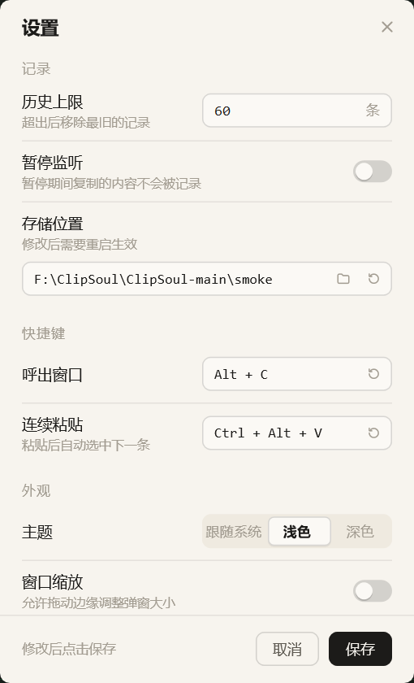
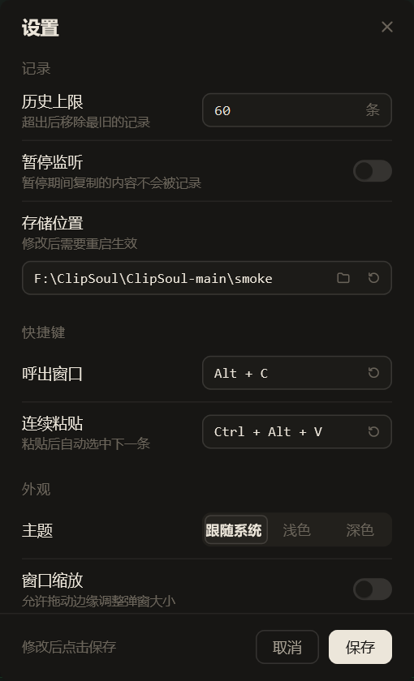

# ClipSoul

ClipSoul 是一个 Windows 原生剪贴板历史工具，目标是**轻量、快速、常驻后台**，并突破 Windows 自带剪贴板历史 25 条的限制。

纯 C++/Win32 + Direct2D 实现，单文件 exe 不到 1 MB，空闲时几乎不占内存。

<p align="center">
  
</p>

<p align="center">
  
  
</p>

## 特性

- **轻量**：C++/Win32 原生实现，单个 exe 约 850 KB，空闲内存按需回收
- **快速呼出**：托盘常驻，默认 `Alt+C` 呼出/隐藏，窄小的 Win+V 风格弹窗
- **主题跟随**：跟随系统 / 浅色 / 深色三种模式，切换时配色渐变过渡
- **持久化历史**：支持文本、链接、图片、文件历史，可展开查看长内容
- **查找与整理**：搜索、筛选、收藏夹分组、置顶、备注
- **批量操作**：多选、全选、选中删除、选中粘贴
- **连续粘贴**：默认 `Ctrl+Alt+V`，粘贴后自动选中下一条
- **可配置**：自定义历史条数（默认 60）、自定义存储位置、窗口缩放

## 下载

前往 [Releases](https://github.com/Yuntun1020/ClipSoul/releases) 下载最新的 `ClipSoul.exe` 与 `SHA256SUMS.txt`。

首次启动后，默认会在 `ClipSoul.exe` 所在目录生成：

```text
clipsoul.db
cache\
```

如果在设置中选择了自定义存储位置，会在 exe 所在目录写入 `clipsoul.storage`。修改存储位置后需要重启程序生效。

## 构建

需要 Windows、Visual Studio 2022/MSVC、CMake 3.25+。

```powershell
cmake -S . -B build
cmake --build build --config Release --target clipsoul
```

生成文件：

```text
build\Release\clipsoul.exe
```

## 测试

```powershell
cmake --build build --config Release --target clipsoul_tests
.\build\Release\clipsoul_tests.exe
```

## 快捷键

| 操作 | 默认快捷键 |
| --- | --- |
| 呼出 / 隐藏弹窗 | `Alt+C` |
| 连续粘贴 | `Ctrl+Alt+V` |
| 粘贴选中项 | `Enter` |
| 关闭弹窗 | `Esc` |

均可在设置页中修改。

## 安全与校验

ClipSoul 是开源的本地剪贴板工具，**不联网**。它会常驻后台、监听剪贴板变化、注册全局热键，并在用户选择历史项时写入剪贴板和触发粘贴。这些行为和部分自动化/监控类软件相似，未签名版本可能被 Windows Defender 或 SmartScreen 误报。

发布页会同时提供：

```text
ClipSoul.exe
SHA256SUMS.txt
```

下载后建议先校验哈希：

```powershell
Get-FileHash -Algorithm SHA256 .\ClipSoul.exe
```

确认输出值与 `SHA256SUMS.txt` 中的值一致后再运行。如果哈希不一致，请删除文件并重新从 GitHub Release 下载。

当前发布版暂未代码签名。如果 Windows 拦截但哈希一致，通常是未签名新程序的信誉/误报问题；仍建议只从官方 Release 下载，不要从聊天软件缓存目录或第三方网盘直接运行。

## 更新日志

见 [CHANGELOG.md](CHANGELOG.md)。
